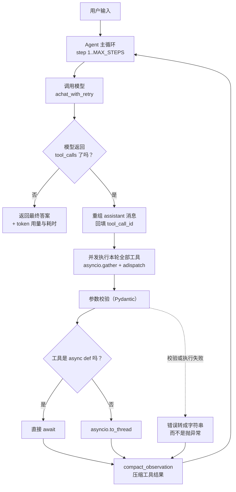

# agent-playground

**从零手写的 AI Agent 系统**——不依赖 LangChain 等框架，核心链路全部自己实现。

包含两种 Agent 范式（原生 Function Calling / 文本式 ReAct）、工具注册表、
SSE 流式解析、上下文压缩、asyncio 并发执行与失败隔离、**知识库检索（RAG）**，
以及 **76 个零 API 成本的单元测试**。

| 实测结果 | 数据 |
|---|---|
| 上下文压缩 | 输入 token **−42%**（2175 → 1253）、总成本 **−28%**，信息覆盖 5/5 零丢失 |
| 批量并发 | 5 个任务耗时 **8.25s → 2.02s（4.1x）**，token 消耗差异 <1% |
| RAG 检索 | 按 Markdown 结构切块后，recall@3 **0.81 → 0.94**、端到端 **0.80 → 0.93** |
| 测试 | **76 个**用例，**不需要 API key、不产生费用**（裸跑约 0.6 秒，带覆盖率约 1.3 秒） |

## 这个项目做了什么

一句话：**把「调一次大模型」这件事，做成一个可测试、可观测、能并发、能算成本的系统。**

大多数 LLM 应用是一条直线——拼 prompt、发请求、打印结果。直线代码的问题不是跑不通，
而是**出问题时看不见、想改又不敢动**。这个项目把直线拆成了分层结构：

- **配置层** `config.py`：配置集中读取并校验，写错在启动阶段就报错，而不是跑到一半才崩
- **客户端层** `llm_client.py`：同步流式 `stream_chat` + 异步 `achat`，统一处理超时、重试与 SSE 解析
- **工具层** `tools.py`：`@tool` 装饰器注册 + Pydantic 参数校验，同步/异步工具统一分发
- **Agent 层** `agent.py` / `react_agent.py`：主循环、上下文压缩、并发工具执行、trace 记录
- **检索层** `rag.py`：文档切块、TF-IDF 稀疏向量、余弦相似度检索，把结果拼进 prompt
- **观测层** `logging_config.py` / `cost.py` / `trace.py` / `replay.py`：结构化日志、成本估算、过程可回放
- **评测层** `eval_set.py` / `eval_rag.py`：30 条评测集，召回 / 拒答 / 端到端三层指标

整体链路（`agent.py::arun_agent` 的实际控制流）：



四个我认为有难度的点：

1. **工具并发**：同步工具必须用 `asyncio.to_thread` 包装，否则会阻塞事件循环——
   漏掉包装时并发会**静默失效**（实测 1.00s 退化成 3.00s，不报任何错）
2. **上下文压缩**：做了四版对照实验，最终选择「按日志级别筛选」（输入 token 降 42%、成本降 28%，且信息零丢失），
   而不是「按位置头尾截断」（省得更多，但会丢掉分散在日志中间的信息）
3. **可测试性**：让 `achat` 接受注入的 client、让退避与高峰时段判断接受注入的时间，
   才能在不联网、不等待的前提下测出并发与重试逻辑
4. **RAG 的度量**：先建评测集、再用数据去改切块——按 Markdown 标题切让 recall@3 从 0.81 升到 0.94；
   而同期的另外两处切块修复（写得更「正确」）指标一点没动。**修缺陷和提指标是两件事。**

## 实测数据

下面的数字全部来自真实 API 调用（`deepseek-flash`，关闭思考模式）。
原始记录与实验脚本见 [`docs/agent_notes.md`](docs/agent_notes.md) 和 [`docs/async_notes.md`](docs/async_notes.md)。

### 1. 上下文压缩：token 降 42%、成本降 28%，且信息零丢失

四种压缩策略跑同一个日志分析任务（读取 3203 字符的日志，需要回答 5 类问题）。
注意「输入 token 降幅」和「成本降幅」不是同一个数——压缩只作用于输入，
输出 token 不受影响，所以成本的降幅总是小于 token 的降幅：

| 版本 | 策略 | 总输入 token | 信息覆盖 | 成本 |
|---|---|---|---|---|
| v0 | 不压缩 | 2175 | 5/5 | ¥0.00438 |
| v1 | 头尾截断 800 字符 | 1032 | **3/5** ❌ | ¥0.00283 |
| v2 | 按日志级别筛选 · 40 行 | 1866 | 5/5 | ¥0.00390 |
| **v3** | **按日志级别筛选 · 20 行** | **1253** | **5/5** | **¥0.00317** |

**结论**：压缩策略必须匹配内容的**信息分布**。日志里的错误与告警散落在全篇，
按位置截断（v1）省得更多（输入 token −53%、成本 −35%），却丢掉了「慢查询」和「认证失败」两类问题；
按级别筛选（v3）只降 42%，但信息一条没丢，答案质量反而更好。**删得对，比删得多更重要。**

### 2. 工具并发：3.0x

同一轮里并发执行 3 个工具：

| 工具类型 | 串行 | 并发 | 加速 |
|---|---|---|---|
| 异步工具（`async def`，各 1.5s） | 4.52s | **1.50s** | **3.0x** |
| 同步工具 + `to_thread`（各 1.0s） | 3.00s | **1.00s** | **3.0x** |
| 同步工具、**漏掉** `to_thread` | 3.00s | 3.00s | **1.0x** ❌ |

**结论**：不阻塞事件循环是并发生效的前提。漏掉 `to_thread` 时并发会**静默失效**——
不报错、不警告，只是悄悄退回串行速度。这类问题只能靠实测发现，读代码发现不了。

### 3. 批量并发：4.1x，但 token 不变

5 个 Agent 任务，每个都含工具调用：

| 并发上限 | 串行 | 并发 | 实测加速 | 理论上限 |
|---|---|---|---|---|
| 3 | 7.87s | 3.52s | **2.2x** | 2.5x |
| 5 | 8.25s | **2.02s** | **4.1x** | 5.0x |

同样任务下的 token 消耗：

| 并发上限 | 串行 | 并发 | 差异 |
|---|---|---|---|
| 3 | 10087 | 10028 | **−0.6%** |
| 5 | 10100 | 10095 | **−0.05%** |

**结论**：加速比的上限由「批次大小」和「最慢的那个任务」共同决定，不是简单的任务数；
而 token 消耗几乎不变——**并发压缩的是等待时间，不是工作量**。

### 4. 客户端复用：+52% ~ +61%

6 个任务，一次各自创建 `AsyncClient`，一次全程共享同一个：

| 运行 | 独立 client | 共享 client | 提升 |
|---|---|---|---|
| 第一次 | 1.84s | 0.88s | **约 +52%** |
| 第二次 | 1.78s | 0.70s | **约 +61%** |

**归因**：`httpx.AsyncClient()` 初始化会**同步**加载 CA 证书，
20 次构造实测中位数 149.6ms，每次约 150ms，6 次合计约 900ms——
与实测差异（0.96s / 1.08s）吻合。所以这省下的不只是连接池，
而是「初始化本身就在阻塞事件循环」这件事。

### 5. 失败隔离：从「程序崩溃」到「5/6 成功可追溯」

6 个任务，其中 1 个必然失败：

| 场景 | 成功数 | 结果 |
|---|---|---|
| 无隔离（初版） | 0/6 | ❌ **程序直接崩溃** |
| 有隔离、无重试 | 5/6 | ✅ 失败可追溯 |
| 有隔离 + 重试 | 5/6 | ✅ 重试后放弃并记录原因 |

**结论**：并发系统里**失败是常态，不是异常**。Agent 层兜住 `HTTPError`、
`gather` 层兜住其余异常，一次失败才不会拖垮一整批。
注意第三种场景耗时更长（串行 9.09s）——重试是有代价的，不是白拿的。

### 6. 两种 Agent 范式对照

同一个问题，`agent.py`（原生 Function Calling）与 `react_agent.py`（文本式 ReAct）各跑一遍：

| 问题 | 实现 | 步数 | 输入 token | 输出 token | 耗时 | 成本 |
|---|---|---|---|---|---|---|
| 幂运算 | function calling | 2 | 1440 | 56 | 1.48s | ¥0.001797 |
| 幂运算 | ReAct | 2 | 634 | 70 | 1.39s | ¥0.000987 |
| 日志总结 | function calling | 2 | 2064 | 436 | 2.66s | ¥0.004113 |
| 日志总结 | ReAct | 2 | 1254 | 375 | 2.86s | ¥0.002974 |
| 双工具 | function calling | 2 | 1487 | 98 | 1.45s | ¥0.002029 |
| 双工具 | ReAct | 3 | 1068 | 132 | 2.64s | ¥0.001724 |

| 差异 | 数据 | 归因 |
|---|---|---|
| ReAct 输入 token 全面更低 | −28% ~ −56% | JSON Schema 比自然语言说明长 4.56 倍，而且每步都要重发 |
| ReAct 偶尔需要更多步数 | 双工具任务 3 步 vs 2 步 | **文本格式一次只能输出一组 Action，不支持并行工具调用** |
| ReAct 复杂任务更慢 | 2.64s vs 1.45s（+82%） | 多一次往返，而每次往返都要重发全部上下文 |
| ReAct 有格式漂移风险 | — | 结构化协议由 API 保证；文本格式只能靠模型自觉遵守 prompt |

**结论**：没有绝对优劣——要「token 便宜 + 过程可见」选 ReAct，
要「协议可靠 + 支持并行工具调用」选 Function Calling。
这也解释了为什么生产环境普遍选后者：**工具一多，格式漂移就成了主要故障源。**

### 7. RAG 检索与评测

30 条评测集（事实型 15 / 综合型 9 / 无答案型 6），三层指标分开测，
失败才能归因到「检索没找到」「检索不完整」还是「生成答错」：

| 指标 | 优化前 | 优化后 | 说明 |
|---|---|---|---|
| recall@3 | 0.81 | **0.94** | 检索层，纯计算、零成本 |
| recall@5 | 0.90 | **0.96** | |
| 端到端准确率 | 0.80 | **0.93** | 生成层，4 道题从错变对、**0 道退步** |
| 提示词 tokens | 15,630 | **12,860（−18%）** | 块更短更聚焦，反而更省 |

优化本身只有一处：**按 Markdown 标题切块，并把标题作为块的前缀保留**
（改前有 29% 的块跨了两个章节，改后是 0%）。

**消融实验**：同期还改了两处——重叠不再按字符数截取（修掉 51 个以残缺表格行开头的块）、
超长段落按行硬切且表格片段重复表头。两处都让代码更正确，
**但指标完全没有变化**，说明那些缺陷本来就没被命中过。

失败分析、`none` 类「检索层拒答率 0% 但生成层 100%」的两层反转、
以及一处「评估过但决定不做」的改动（相似度阈值）见 [`docs/rag_eval.md`](docs/rag_eval.md)。

这些数字依赖**语料和评测集的内容**——改一份文档（连 README 也算）就会改变结果。
所以报告里记了两个内容指纹，每次运行比对，不一致就提示「基线需要重跑」。
这不是多虑：把评测报告本身放进 `docs/` 之后，端到端从 0.93 掉到 0.83
（报告里逐题讨论了题目和答案，成了自指污染），最后把报告排除出检索语料才修好。

## 环境要求

- Python 3.12+
- [uv](https://docs.astral.sh/uv/)（包与环境管理器）

## 快速开始

```bash
git clone https://github.com/Icelemon77/agent-playground.git
cd agent-playground
cp .env.example .env        # Windows: copy .env.example .env
uv sync
```

### 怎么配 API Key

编辑项目根目录的 `.env`，至少填入 `LLM_API_KEY`：

| 变量 | 默认值 | 说明 |
|---|---|---|
| `ENV` | `dev` | 运行环境，只接受 dev / staging / prod |
| `LOG_LEVEL` | `INFO` | 日志级别 |
| `LLM_API_KEY` | 空 | **必填**，从服务商开放平台获取 |
| `LLM_BASE_URL` | `https://api.deepseek.com/v1` | 接口地址，需兼容 OpenAI 协议 |
| `LLM_MODEL` | `deepseek-flash` | 模型名 |
| `REQUEST_TIMEOUT` | `30` | 请求超时秒数，范围 1–300 |

两点约定：

- **`.env` 永不提交**（已在 `.gitignore` 中）。`.env.example` 只放键名和默认值，不放真实密钥。
- 配置的取值优先级是 **系统环境变量 > `.env` 文件 > 代码里的默认值**，
  由 `src/agent_playground/config.py` 的 `Settings` 统一读取并校验，配置写错会在启动阶段直接报错。

换服务商只需改 `.env` 里的两行（`LLM_BASE_URL` 和 `LLM_MODEL`），代码不用动。

### 怎么运行 CLI

```bash
uv run python -m agent_playground.cli
```

启动后直接输入问题，回答会**逐字流式输出**：

```
输入问题开始对话。命令：/exit 退出  /clear 清空  /stats 统计  /think 思考显示

你 > 我叫lemon，是一名大三学生
AI > 你好，lemon！很高兴认识你，大三同学。有什么我可以帮你的吗？
[本轮 54+101 tokens / 1.18s / finish=stop]
```

**内置命令**

| 命令 | 作用 |
|---|---|
| `/exit` | 退出并打印本次会话统计 |
| `/clear` | 清空对话历史（保留系统提示） |
| `/stats` | 查看累计 token 与预估花费 |
| `/think` | 切换是否显示模型的思考过程（推理模型才有） |

`Ctrl+C` 也可以退出，同样会打印统计。**注意命令必须带斜杠**——输 `exit` 会被当成正常提问发给模型。

退出时输出：

```
本次会话：输入 252 tokens，输出 233 tokens
预估花费：¥0.001279
```

## 目录结构

```
src/agent_playground/
├── config.py          配置加载与校验（Pydantic Settings）
├── errors.py          异常体系（LLMCallError 携带 status_code）
├── logging_config.py  控制台 + JSONL 双格式日志
├── cost.py            token 成本估算（含高峰时段判断）
├── text_utils.py      文本处理小工具
├── prompts.py         系统提示词（集中管理，避免多个入口不一致）
├── context.py         上下文压缩（按内容类型选择策略）
├── rag.py             知识库检索：切块 + TF-IDF 稀疏向量 + 余弦相似度
├── tools.py           工具注册表：@tool 装饰器 + 同步/异步分发
├── llm_client.py      LLM 客户端：同步流式 + 异步 achat + 重试
├── agent.py           Agent 主循环：同步流式 + 异步并发（arun_agent）
├── react_agent.py     文本式 ReAct Agent（另一条实现路线）
├── trace.py           每次运行的独立记录
├── replay.py          trace 回放
├── batch.py           批量并发任务
├── eval_set.py        评测集加载与质量门禁（校验评测集本身是否可靠）
├── eval_rag.py        RAG 评测：召回 / 无答案拒答 / 端到端三层指标
├── cli.py             交互式命令行对话
└── main.py            启动链路自检入口

tests/
├── conftest.py        测试共享的假 client 与响应工厂
├── test_tools.py      工具与分发
├── test_text_utils.py 文本工具
├── test_context.py    上下文压缩（含回归用例）
├── test_cost.py       成本估算
├── test_llm_client.py LLM 客户端（mock，不花 API 费用）
└── test_agent.py      Agent 主循环
```

## 实现说明

**流式输出**：通过 HTTP SSE（Server-Sent Events）接收分片，逐片解析 `data: {...}` 行，
遇到 `data: [DONE]` 结束。相比非流式，首字延迟从等待整段生成缩短到几百毫秒。

**成本统计**：从响应的 `usage` 字段取 token 用量，按服务商定价换算
（价格与来源见 `cost.py` 顶部注释）。流式调用需要显式传
`stream_options: {"include_usage": true}` 才会返回用量。

**上下文管理**：模型本身没有记忆，每轮都要把完整历史重新发过去。
`cli.py` 只保留最近 `MAX_TURNS` 轮，避免 token 成本随轮数无限制增长
（实测：第 1 轮输入 54 tokens，20 轮后涨到 1285 tokens）。

**工具调用**：模型不执行任何函数，它只输出「调用哪个工具、传什么参数」，
真正执行的是本项目的代码。完整链路是「模型请求调用 → 代码执行 → 结果回传 → 模型生成答案」，
最多循环 `MAX_STEPS` 步，因此支持连续调用多个工具。
工具执行失败时，错误会被转换成字符串回传给模型（而不是抛异常让程序崩溃），
由模型决定重试或向用户说明。

## 支持的工具

模型可以调用以下工具（定义见 `src/agent_playground/tools.py`）：

| 工具 | 参数 | 说明 |
|---|---|---|
| `calculator` | `expression` | 计算数学表达式 |
| `get_current_time` | `timezone` | 获取指定时区的当前时间 |
| `read_file` | `filename` | 读取 `data/` 目录下的文本文件（限制在该目录内） |
| `list_files` | 无 | 列出 `data/` 目录下的文件名 |
| `fetch_weather` | `city` | 查询城市天气（**模拟实现**，固定延迟 1.5s，仅用于并发实验） |
| `search_knowledge` | `query` | **在项目自己的知识库（`docs/` 与 README）里检索**，返回最相关的片段（带来源与相似度） |

### 运行 Agent

```bash
uv run python -m agent_playground.agent "读取 data/numbers.txt，然后把里面所有数字相加"
```

Agent 会在需要时自动调用工具，并且可以**连续调用多个工具**完成任务。
工具执行失败时，程序不会崩溃——错误会被回传给模型，由模型决定重试或向用户说明。

`search_knowledge` 让 Agent 能回答自己文档里的问题——**由模型自己决定要不要检索、用什么关键词检索**，
而不是写死「每问必查」的流程：

```bash
uv run python -m agent_playground.agent "根据知识库，我的项目是怎么优化上下文成本的？"
```

也可以绕过 Agent、直接跑检索加生成这条固定流程（用来对比两种形态）：

```bash
uv run python -m agent_playground.rag "我的项目在不做上下文压缩时，单次任务的总输入是多少 token？"
```

## 两种 Agent 实现

项目里有两条 Agent 实现路线，用于对比学习：

| 入口 | 范式 | 工具调用方式 |
|---|---|---|
| `agent.py` | 原生 Function Calling | 通过 `tools` 参数，走 API 的 `tool_calls` 协议 |
| `react_agent.py` | 文本式 ReAct | 靠 prompt 约定格式，自己用正则解析 |

```bash
# 同一个问题，两种实现各跑一遍
uv run python -m agent_playground.agent "读取 data/app.log，总结里面出现了哪些问题类型"
uv run python -m agent_playground.react_agent "读取 data/app.log，总结里面出现了哪些问题类型"
```

运行后会生成 `logs/trace_*.jsonl`，可以回放完整的推理过程：

```bash
uv run python -m agent_playground.replay logs\trace_20261010_153000.jsonl
```

三种任务的逐项对照（步数、token、耗时、成本）见上文「实测数据」第 6 节。

**怎么选：**

- 需要**并行调用多个工具** → function calling（ReAct 的文本格式一次只能输出一组 Action）
- 需要看到模型的**推理过程**、需要人工审核断点 → ReAct
- **工具很多** → function calling（结构化协议更可靠，不会因格式漂移失败）

详细分析和踩坑记录见 [`docs/agent_notes.md`](docs/agent_notes.md)。

## 异步与并发

批量任务支持并发执行（5 个 Agent 任务，每个含工具调用，数据见上文「实测数据」第 3 节）：

```bash
uv run python -m agent_playground.batch 5
```

**token 消耗不变**（差异 < 1%）——并发只压缩时间，不减少工作量。

设计要点：

- **工具按同步/异步分流**：`async def` 工具直接 `await`，同步工具用 `asyncio.to_thread` 包装，
  避免阻塞事件循环（漏掉包装会让并发静默失效，实测 1.00s 变 3.00s）
- **客户端全程复用**：`httpx.AsyncClient` 初始化要同步加载 CA 证书，每次约 150ms，
  6 个任务各自创建会白付 900ms
- **单个任务失败被隔离**：失败返回带 `error` 字段的结果，不影响批次其他任务
- **可恢复的错误自动重试**：指数退避 0.5s → 1s → 2s，4xx 立刻放弃
- **`Semaphore` 限制并发数**，`asyncio.wait_for` 控制单请求总时限

详细分析、六组实测数据和踩坑记录见 [`docs/async_notes.md`](docs/async_notes.md)。

## 设计取舍

几个刻意的决定，以及背后的原因：

1. **不引入 Agent 框架**。框架会隐藏「模型请求调用 → 代码执行 → 结果回传」这条链路。
   自己写一遍才知道：`tool_calls` 里的 `arguments` 是一段 JSON **字符串**（不是对象），
   而且回传结果时必须带上对应的 `tool_call_id`，模型才能把结果和请求对上号。

2. **链路上不允许出现同步阻塞**。只要混进一个阻塞调用，异步并发就整体失效，而且**不会报错**。
   所以工具层强制区分 `async def` 与 `def`，后者一律用 `to_thread` 包装。

3. **失败不进异常，进数据**。工具执行失败不抛异常，而是转成字符串回传给模型；
   批量任务里单个失败返回带 `error` 字段的结果。于是一次失败不会让整批任务白跑。

4. **关键参数做成可注入的，而不是硬编码**。`base_backoff`、`is_peak_now(now=None)`、
   `client=None` 这类参数存在的唯一目的就是「可测试」——测不了的时间，等于没测。

5. **压测用真 API，回归用假 client**。性能数字必须来自真实调用（否则不算数），
   但每次改代码都打真 API 既慢又费钱，所以 76 个回归测试全部走假 client。

## 已知限制

- 历史截断策略是「丢弃最早的」，没有做摘要压缩
- 重试只覆盖网络层异常和 429/5xx，没有熔断与降级策略
- 并发上限需要手动指定，没有根据服务端限流自适应调整
- 成本估算基于 2026-10-08 抓取的价格，且未处理中国法定节假日
- **RAG 用的是 TF-IDF 稀疏向量**：同义词匹配不到（搜「报错」找不到写「异常」的段落）。
  服务商没有 embedding 接口，换稠密向量需要另一个 key——代码里已留好替换点
  （`TfidfIndex._vectorize` 一个方法）
- **评测集只有 30 条，1 道题 = 3.3 个百分点**，识别不了小幅波动；
  要定阈值一类的参数，样本量得再上一个数量级
- `rag.py` / `eval_set.py` / `eval_rag.py` **还没有单元测试**，
  所以整体覆盖率从 40% 降到 28%——这是新增模块的缺口，不是原有代码退化
- 测试只覆盖了纯逻辑（工具、压缩、成本）和 Agent 主循环，
  `stream_chat` / `batch.py` / `cli.py` 这类入口尚未覆盖
- `stream_chat` 内部自建 HTTP client，无法注入假对象——需要先重构才能测

## 开发

```bash
uv run ruff format .    # 格式化
uv run ruff check .     # 静态检查
uv run pyright          # 类型检查
uv run pytest           # 单元测试（76 个，约 0.6 秒）
```

测试全部使用假 client（见 `tests/conftest.py`），**不需要 API key、不产生任何费用**，
而且能造出真实 API 造不出的场景（连续 500、7 次工具调用）。

```bash
uv run pytest --cov=src/agent_playground --cov-report=term-missing
```

当前语句覆盖率 28%（1196 条语句，未覆盖 859 条）。未覆盖的部分集中在
`rag.py` / `eval_set.py` / `eval_rag.py` 这三个新模块，以及
`react_agent.py` / `batch.py` / `cli.py` 这些入口脚本上——是已知缺口，不是遗漏。

RAG 这部分的验证换了一种方式：**先建评测集**（而不是写单测），
用 30 条问答对测召回和端到端准确率。评测集自己也有质量门禁：

```bash
uv run python -m agent_playground.eval_set           # 校验评测集本身（格式、配比、expect 是否真实存在）
uv run python -m agent_playground.eval_rag --no-e2e  # 只测检索，零 API 成本
uv run python -m agent_playground.eval_rag --tag baseline  # 完整评测，约 ¥0.02 一次
```
